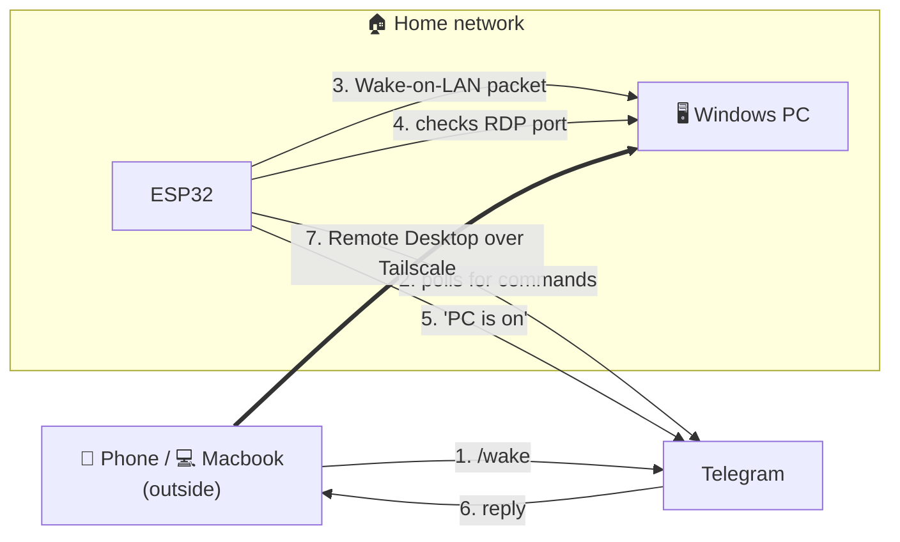

# esp32-pc-wake

## Why I made this

Sometimes I need to work outside. I bring my Macbook Air M2, but when I run heavy tasks it gets slow and overheats. My PC at home handles them much better, so I prefer to work on the PC remotely and just use the macbook (or my phone) as a screen.

My remote setup:

- **Tailscale** on my phone, macbook and PC, so they are on the same private network wherever I am.
- **Windows Remote Desktop** turned on on the PC.
- **Windows App** (Microsoft's remote desktop app) on the Macbook and phone, connecting to the PC's Tailscale IP.

This works great, but only if the PC is on. I didn't want to keep it on all day, and I also didn't want to open ports on my router. So I made this small thing with an ESP32 and a Telegram bot to turn the PC on when I need it.

## How it works



1. I send `/wake` to my bot.
2. The ESP32 at home sends a Wake-on-LAN packet to the PC.
3. It keeps checking the PC's RDP port, and tells me when the PC is really on.
4. I open Windows App and connect to the PC through Tailscale.

For my PC, it takes about 20 seconds from `/wake` until I get "PC is on".

The ESP32 only talks to Telegram, so no port forwarding, VPN or server needed. It also doesn't need Tailscale, it just checks the PC with the home LAN IP. Tailscale is only for my macbook and phone to reach the PC.

Sharing it here in case it's useful for someone.

## What I used

- ESP32-WROOM-32 (mine has a CH340 USB chip)
- Windows 11 Pro PC, connected with an ethernet cable (WoL over wifi usually doesn't work)
- 2.4 GHz wifi on the same network as the PC (ESP32 can't use 5 GHz)
- A Telegram bot from [@BotFather](https://t.me/BotFather)
- My numeric Telegram user ID from [@userinfobot](https://t.me/userinfobot)
- [arduino-cli](https://arduino.github.io/arduino-cli/latest/installation/), because I didn't want to use Arduino IDE

## Setup

### 1. Secrets

Copy `secrets.example.h` to `secrets.h`, then fill in your wifi SSID/password, bot token and user ID.

```bash
cp secrets.example.h secrets.h
```

`secrets.h` is in `.gitignore`, so it won't get committed. Only your user ID can use the bot, messages from anyone else are ignored.

### 2. PC MAC and IP

`config.h` still has my PC's values, so change them to yours:

- `PC_MAC`: the MAC of the PC's **ethernet** adapter (not the ESP32). Run `ipconfig /all` and look for "Physical Address".
- `PC_LAN_IP`: the PC's LAN IP from `ipconfig`. Don't use a Tailscale or VPN IP.

If you leave `PC_LAN_IP` as `0.0.0.0`, `/wake` still works, but you won't get the "PC is on" message.

**Tip: reserve the PC's IP in your router.** My router gives 2 hour DHCP leases, so the PC can get a different IP later. Then the RDP check always says unreachable. On my Ruijie router it's in More → LAN → DHCP Clients → "Convert to Static IP". Other routers call it DHCP reservation or static lease.

### 3. Windows side

- **RDP:** needs Windows Pro, Home doesn't have it. Turn it on in Settings → System → Remote Desktop.
- **Network adapter:** in Device Manager → your ethernet adapter → Advanced, enable "Wake on Magic Packet" (and "Shutdown Wake-On-Lan" if you have it).
- **BIOS:** enable Wake on LAN (sometimes called "Power On By PCI-E" or "Resume by LAN"). If there's "ErP", turn it off.
- **Fast Startup:** many people say you need to turn it off for WoL. For me it works with Fast Startup on, so try first before changing it.

### 4. Adjust the boot wait

After `/wake`, the ESP32 waits `BOOT_CHECK_DELAY_MS` before it starts checking RDP. Then it checks every 3 seconds.

I set it to `20000` because my PC boots in about 20 seconds. **Change it to your PC's boot time.**

Better to set it a bit lower than higher. If it checks too early, it just tries again 3 seconds later. But if it starts too late, you always wait longer for the message.

Other values at the top of `esp32-pc-wake.ino` you might want to change:

| Constant | Mine | What it does |
|---|---|---|
| `BOOT_CHECK_DELAY_MS` | 20000 | Wait after WoL before the first RDP check |
| `BOOT_CHECK_INTERVAL_MS` | 3000 | How often it checks RDP after that |
| `BOOT_CHECK_MAX_MS` | 180000 | Stop and say "still unreachable" after this |
| `WAKE_COOLDOWN_MS` | 30000 | Ignore a second `/wake` right after the first one |
| `MAX_COMMAND_AGE_SEC` | 90 | Ignore old commands, so an old `/wake` doesn't run after an outage |
| `LONG_POLL_SEC` | 20 | How long one Telegram request waits for new messages |

If you change `BOOT_CHECK_MAX_MS`, don't forget to also change the "3 minutes" text in `checkBootProgress()`. I didn't make it automatic.

### 5. Build and upload

The core and library versions are pinned in `sketch.yaml`, so the first compile downloads everything.

```bash
arduino-cli compile .
arduino-cli board list                      # find the port, mine is /dev/ttyUSB0
arduino-cli upload -p /dev/ttyUSB0 .
arduino-cli monitor -p /dev/ttyUSB0 -c baudrate=115200
```

When you see `wifi connected: <ip>` on the serial monitor, send `/status` to the bot.

### If you're on WSL2 like me

WSL can't see the USB port by default, so I used [usbipd-win](https://github.com/dorssel/usbipd-win). In PowerShell (admin):

```powershell
winget install --exact dorssel.usbipd-win    # reopen PowerShell after this
usbipd list                                  # find the CH340/CP210x and its BUSID, mine is 5-1
usbipd bind --busid 5-1                      # only once
usbipd attach --wsl --busid 5-1              # again after every replug or WSL restart
```

Then in WSL, add yourself to the `dialout` group and restart WSL (`wsl --shutdown`). Without this you can't open the port.

```bash
sudo usermod -aG dialout $USER
```

## Commands

- `/wake`: if the PC is already on, it just tells you. If not, it sends the WoL packet, replies "packet sent", and later "PC is on" when RDP is reachable. The packet is sent 3 times because UDP can get lost.
- `/status`: wifi signal, IP, uptime, free memory, failed Telegram calls, and if the PC's RDP is reachable.
- `/help`: command list. Any other text also gets this.

## Problems I ran into

Check the serial monitor first, almost everything shows up there.

**Wifi never connects, log shows `reason=15`**

Wrong wifi password, that was my first problem. If you see `reason=201` instead, it can't find the SSID (check it's 2.4 GHz).

**`telegram ... failed, http=-1` / `-5` / `-11` sometimes**

This was the most annoying one. My ISP sometimes drops connections to Telegram for a few seconds. I tested from my PC with curl and got the same thing, so it's not the ESP32. The code retries and recovers by itself. If it never works at all, check if `api.telegram.org` is reachable from your network.

**Got the same reply twice**

Telegram got the message, but the confirmation got lost, so the ESP32 thought it failed and sent it again. Now it doesn't resend in that case. The downside is that in rare cases a reply can be missing, so just send the command again.

**WSL: `usbipd attach` says device busy**

Something on Windows still had the COM port open. Closing that program should be enough. I ended up using `usbipd bind --busid <id> --force`, but it doesn't work right away, you may need to replug the ESP32 or reboot first.

**WSL: `usbipd attach` says already attached**

Happened after I restarted WSL. Run `usbipd detach --busid <id>`, then attach again.

## Other things that can go wrong

I didn't hit these, but they are easy to check:

- `http=401`: wrong bot token.
- `http=409` all the time: something else is using the same bot token.
- Bot ignores you: `AUTHORIZED_USER_ID` must be your numeric user ID, not your username.
- `/status` says RDP unreachable but the PC is on: check `PC_LAN_IP`, the router reservation, and that RDP is enabled.

## What I tested so far

Tested on my ESP32-WROOM-32 and Windows 11 Pro PC, with core 3.3.12 and ArduinoJson 7.4.3:

- Compile and upload from WSL2
- Wifi, NTP and Telegram long polling
- `/status` with the RDP check
- `/wake` when the PC is already on
- `/wake` from shutdown until "PC is on" (about 20 seconds)
- Recovering from the Telegram network failures above

Not tested yet:

- Recovery after the wifi or router goes down
- The restart after 5 minutes without Telegram
- The outbox (failed replies retried later) and the no-resend rule, because I can't make the network fail at the right moment
- WoL after a power outage (many boards ignore WoL until you turn the PC on once)
- Running for many days

## Things to know

- "Packet sent" doesn't mean the PC turned on. That's why it waits and tells you "PC is on".
- "RDP reachable" means Windows is up, not that someone is logged in. And unreachable doesn't always mean the PC is off.
- If the home internet, router, wifi or the ESP32 power is down, nothing works. No way around that.
- Replies can come a bit late when the network is bad. A failed reply is kept and tried again every 10 seconds, for up to 3 minutes.
- If the ESP32 can't reach Telegram for 5 minutes, or gets stuck, it restarts by itself.
- It uses the Telegram root certificate from the UniversalTelegramBot library. If Telegram changes its certificate one day, update the library.
- The libraries have their own licenses, check them if you want to share a compiled binary.
